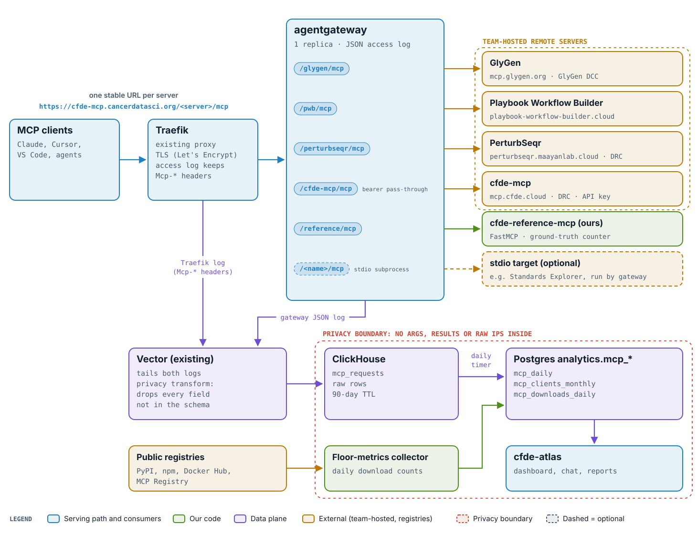
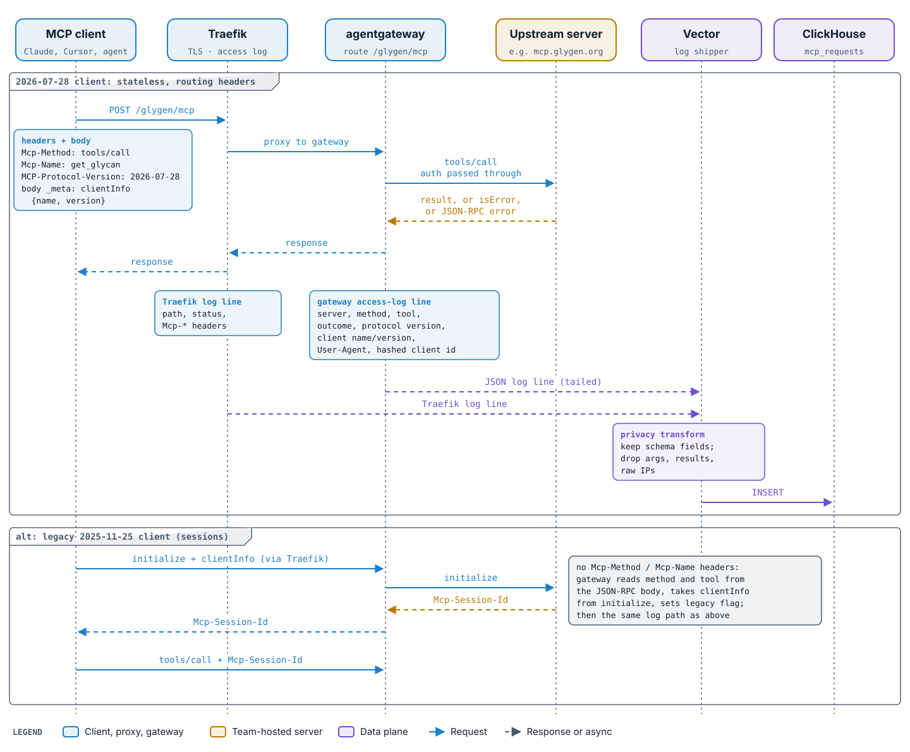
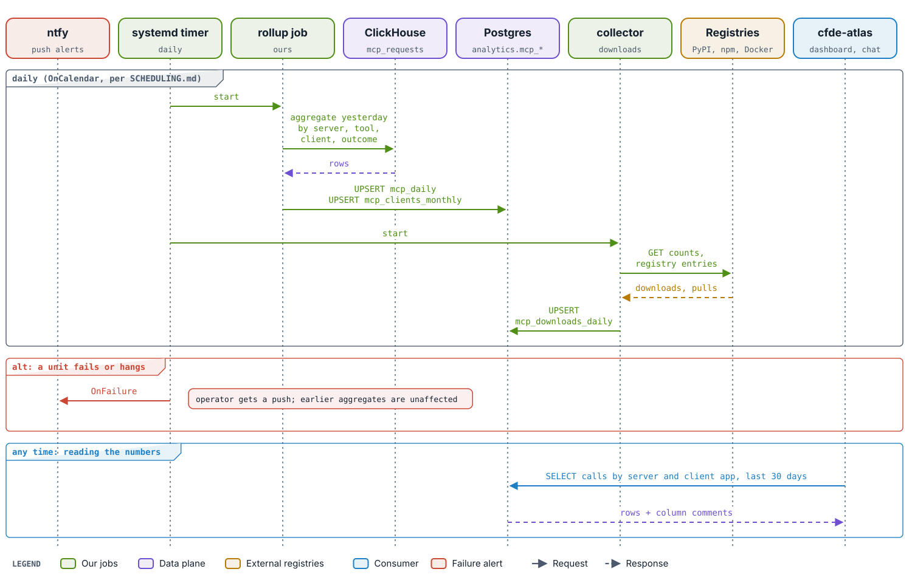
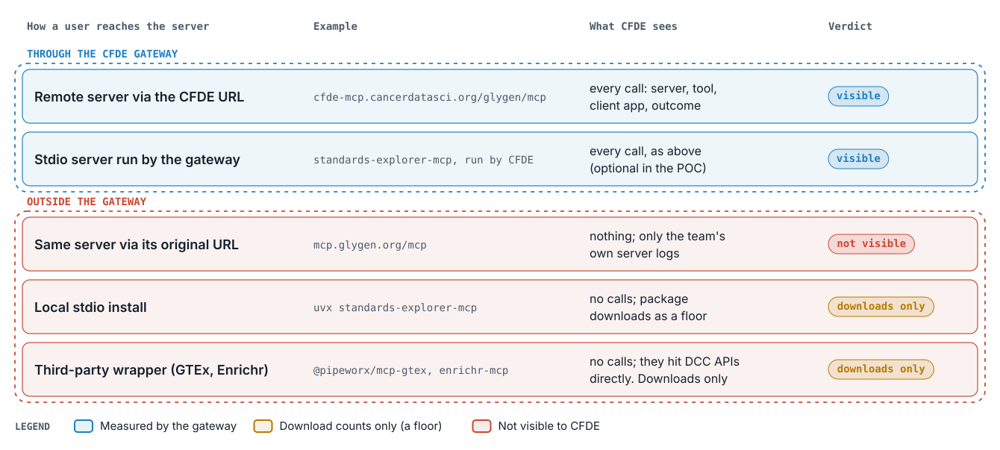

# POC plan: a CFDE MCP gateway with usage metrics

Status: draft, 2026-10-14. Inputs:
[gateways](research/mcp-gateways.md) ·
[usage-metrics approaches](research/mcp-usage-metrics.md) ·
[CFDE inventory](research/cfde-mcp-inventory.md).

## Goal

Front CFDE MCP servers with one gateway at stable per-server URLs and produce
"Google Analytics for MCP" numbers: calls per server and tool, client apps,
distinct clients, and trends, with coarse errors. Those numbers then sit
next to the publications, grants, GitHub and GA4 data CFDE already reports.
Latency is a sanity check only.

## Design in one picture

<picture><source media="(prefers-color-scheme: dark)" srcset="figures/architecture-dark.svg"></picture>

*Blue: serving path and consumers. Green: our code. Violet: data plane. Amber: external (team-hosted servers, public registries). Coral dashed: privacy boundary; nothing past Vector holds tool arguments, results or raw IPs. Dashed boxes are optional.*

## Decisions

Recommended defaults below. The **open** ones are flagged for Sean before
the phase that depends on them.

| # | Decision | Default | Why |
|---|---|---|---|
| D1 | Gateway | **agentgateway** (Apache-2.0), with IBM ContextForge as the fallback if the spike fails | Per-tool counters, stdio targets, both spec generations, args off by default ([gateways §5](research/mcp-gateways.md)) |
| D2 | Hostname | `cfde-mcp.cancerdatasci.org`, grey-cloud, LE cert via Traefik | Fits existing Traefik/TLS pattern (monode `infrastructure/INDEX.md`). A CFDE-owned domain can come later as a DNS change. |
| D3 | Routing | One path per server; **no** aggregated endpoint in the POC | Keeps OAuth and attribution intact ([gateways §4c](research/mcp-gateways.md)) |
| D4 | Log sink | Vector → ClickHouse, not Prometheus/Loki/Tempo | Platform rule: ClickHouse + Vector is the telemetry backbone, and no Grafana/OTel collector for one operator (monode `infrastructure/TELEMETRY.md`). The gateway's `/metrics` endpoint is used only to cross-check in the spike. |
| D5 | Dashboard | **Open.** Default: daily aggregates into Postgres `analytics.mcp_*`, read through cfde-atlas, plus a static summary page. Alternative: Grafana on ClickHouse. | cfde-atlas is already the CFDE metrics surface; Grafana contradicts D4's platform rule unless we decide otherwise. |
| D6 | Privacy | No tool arguments, results, or raw IPs stored. Distinct client = HMAC(salt, IP + User-Agent), salt in GSM rotated **monthly**. Raw rows 90 days, aggregates kept. | Monthly rotation allows monthly-unique counts but no long-term tracking. **Open:** NIH/privacy sign-off on monthly vs daily salt. |
| D7 | Reference server | `cfde-reference-mcp`, FastMCP (Python, uv), in this repo, with a server-side call counter | Ground truth for the ±5% check, a Python-stack test bed, and a safe place to experiment |
| D8 | Header-only control | Add `Mcp-Method`, `Mcp-Name`, `Mcp-Protocol-Version` to Traefik's kept headers (monode PR) | A zero-cost baseline that shows what the MCP-aware gateway adds |

## Phases

Each phase is a GitHub milestone. Its issues are listed in the phase.

### Phase 0: Repo and project setup
- LICENSE (MIT), CONTRIBUTING, PR template, labels, milestones.
- justfile and CI (ruff, pyright, pytest), added when Phase 2 brings code.

**Exit:** issues and milestones exist; the plan is merged.

### Phase 1: Gateway spike (local)
Run agentgateway locally with routes to GlyGen, PWB and PerturbSeqr (public, no auth). Verify with real evidence:
1. Per-server and per-tool counts appear in the access log and in `mcp_requests_total`.
2. The access log can carry `clientInfo.name`/`version` (CEL field from the `initialize` body or `_meta`). If it can't, fall back to User-Agent and record what that yields per client.
3. Tool errors (`isError`) and JSON-RPC errors are distinguishable from success.
4. Both a 2025-11-25 client (sessions) and a 2026-07-28 client work through it.
5. No arguments or results appear in any log by default.

**Exit:** a short findings note in `docs/spike-agentgateway.md`, and a go/no-go on D1.

### Phase 2: Reference server and traffic generator
- `cfde-reference-mcp`: 3–4 trivial tools (one always errors), Streamable HTTP, and a `/health` route. Logs one line per `tools/call` (the ground truth).
- `just traffic`: a scripted client that makes N known calls per tool with a fixed `clientInfo`, against the gateway or the server directly.
- Tests for both.

**Exit:** the traffic script's counts equal the server's own counts, with the server hit directly.

### Phase 3: Deploy on onclappc02
- `deploy/onclappc02/docker-compose.yml`: agentgateway and the reference server, on the `proxy` network with Traefik labels.
- Gateway config in the repo; routes for reference, GlyGen, PWB, PerturbSeqr, and cfde-mcp (bearer pass-through).
- A `/health` returning "Healthy", and a GCP uptime check (`terraform/apps/cfde_mcp/`, monode PR).
- Add the INDEX.md row (monode PR).
- Secrets (HMAC salt) in GSM under the terraform/README naming scheme.

**Exit:** all five routes work from Claude and from one other client; the uptime check is green.

### Phase 4: Logging pipeline
- ClickHouse migration `mcp_requests` (90-day TTL): timestamp, server, method, tool, outcome (ok / tool_error / rpc_error / http_error), protocol version, client name/version, User-Agent, hashed client, legacy session flag.
- A Vector source and transform from the gateway's JSON log, which drops anything not in the schema (the privacy guard lives here).
- Traefik header fields (D8) via a monode PR.

<picture><source media="(prefers-color-scheme: dark)" srcset="figures/sequence-tool-call-dark.svg"></picture>

*One tools/call. A 2026-07-28 client puts the method, tool and protocol version in headers and clientInfo in the body `_meta`; a legacy 2025-11-25 client opens a session with initialize, and the gateway reads the same fields from the JSON-RPC body. Solid arrows are requests, dashed are responses or async log shipping.*

**Exit:** a traffic-script run shows up in ClickHouse within 5% of the reference server's own count, and nothing else is stored.

### Phase 5: Metrics and dashboard
- A daily systemd timer (per SCHEDULING.md, ntfy on failure) that rolls `mcp_requests` up into Postgres `analytics.mcp_daily` (server × tool × client × outcome) and `analytics.mcp_clients_monthly`, with column comments for cfde-atlas.
- A floor-metrics collector: PyPI, npm and Docker pull counts plus MCP Registry entries for the inventory's packages, into `analytics.mcp_downloads_daily`.
- The dashboard per D5.

<picture><source media="(prefers-color-scheme: dark)" srcset="figures/sequence-daily-rollup-dark.svg"></picture>

*The daily jobs. Green: our jobs. Violet: data plane. Amber: public registries. Coral: the failure alert. Blue: cfde-atlas reading the aggregates.*

**Exit:** cfde-atlas (or the chosen dashboard) answers "MCP calls by server and client app, last 30 days".

### Phase 6: Pilot with teams and evaluation
- Outreach: Ma'ayan Lab/DRC (cfde-mcp, PWB, PerturbSeqr), GlyGen, KC (GenSeCo hosted URL), Bridge2AI (optionally host Standards Explorer as a stdio target), and Taylor Lab (DDKG, instrument before launch).
- Test the cfde-mcp API-key pass-through; ask one team to publish the CFDE URL as canonical.
- An evaluation report against the success criteria, with a recommendation for production (domain, ownership, and a schema for teams that report aggregates instead).

**Exit:** the evaluation report is merged.

## Success criteria
- At least 3 CFDE servers plus the reference server are reachable via stable CFDE URLs, with zero client-visible breakage; at least 1 is authenticated (cfde-mcp).
- Gateway counts agree within 5% with the reference server's own count, and with one cooperating team's count if available.
- The client app is attributed for at least 80% of calls.
- No tool arguments, results, or raw IPs are stored anywhere (checked by a test on the Vector transform).
- At least one team agrees to publish the CFDE URL as canonical.

## Out of scope for the POC

<picture><source media="(prefers-color-scheme: dark)" srcset="figures/coverage-dark.svg"></picture>

*What the gateway can and cannot see. Blue: measured per call. Amber: download counts only, a floor. Coral: not visible to CFDE.*

- Telemetry SDKs embedded in team packages (stdio installs); downloads are the floor.
- Latency SLOs, alerting beyond uptime, multi-replica HA.
- An aggregated `/all/mcp` endpoint.
- Third-party wrappers (GTEx, Enrichr, …): reported only through download counts.

## Risks
- The clientInfo CEL extraction may not work in agentgateway (Phase 1 answers this; the fallback is User-Agent).
- Teams may not switch to the CFDE URL, in which case the gateway sees only the traffic we drive.
- OAuth resource-URL mismatch for authenticated servers ([gateways §4a](research/mcp-gateways.md)).
- OTel MCP semconv is still in Development; ClickHouse column names follow it where they can and can be renamed cheaply.
